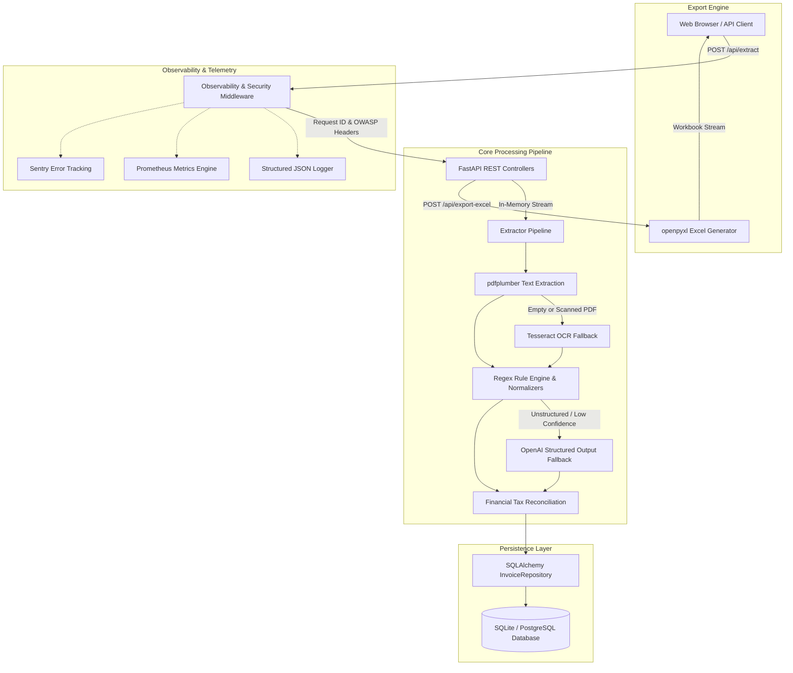
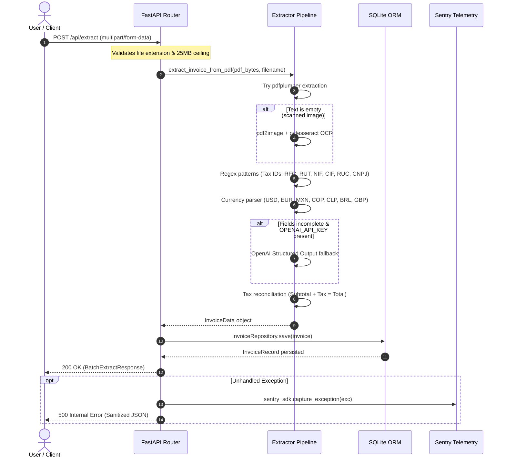

# InvoiceToSheet Architecture & System Design

This document details the software architecture, data flow, pipeline lifecycle, and telemetry infrastructure of the **InvoiceToSheet** microservice.

---

## 1. High-Level Architecture Overview

InvoiceToSheet is designed as a stateless, horizontally-scalable FastAPI microservice specialized in extracting structured financial data from non-standard PDF invoices and consolidating them into enterprise Excel workbooks.

---

## 2. Core Modules & Component Responsibilities

| Module | Responsibility | Key Classes & Functions |
| :--- | :--- | :--- |
| [`main.py`](file:///c:/Users/hflor/Downloads/Pruebas/main.py) | API gateway, route orchestration, CORS, static UI delivery. | `app`, `health_check`, `extract_invoices`, `export_excel`, `get_prometheus_metrics`. |
| [`extractor/`](file:///c:/Users/hflor/Downloads/Pruebas/extractor) | Modular package (`normalizers`, `ocr`, `llm`, `engine`, `pipeline`). | `extract_invoice_from_pdf`, `normalize_amount`, `normalize_date`, `extract_with_llm`, `RegexExtractor`. |
| [`database.py`](file:///c:/Users/hflor/Downloads/Pruebas/database.py) | Persistence layer, ORM models, session management. | `InvoiceRecord`, `InvoiceRepository`, `get_db`, `init_db`. |
| [`excel_generator.py`](file:///c:/Users/hflor/Downloads/Pruebas/excel_generator.py) | Styled Excel spreadsheet generation with formulas. | `generate_invoice_excel`. |
| [`observability.py`](file:///c:/Users/hflor/Downloads/Pruebas/observability.py) | Correlation ID tracing, Prometheus exposition, JSON logging. | `ObservabilityAndSecurityMiddleware`, `SystemMetrics`, `StructuredJsonFormatter`. |
| [`schemas.py`](file:///c:/Users/hflor/Downloads/Pruebas/schemas.py) | Pydantic v2 data contracts, boundary validation schemas. | `InvoiceData`, `BatchExtractResponse`, `ExportExcelRequest`. |

---

## 3. Extraction Pipeline Lifecycle

---

## 4. Multi-Currency Normalization

The normalization engine handles complex regional formatting conventions:

1. **Anglo-Saxon Notation:** `1,234.50` -> comma as thousand separator, period as decimal separator.
2. **European / South American Notation:** `1.234,50 €` / `R$ 4.500,75` -> period as thousand separator, comma as decimal separator.
3. **Chilean Peso (CLP):** Non-decimal whole units `CLP $ 850.000` -> normalized to `850000.0`.
4. **Auto-Reconciliation:** If subtotal and total are detected but tax amount is missing, tax is mathematically reconciled as `round(total - subtotal, 2)` with standard tax rate verification.

---

## 5. Telemetry & Metrics Design

The service provides dual observability endpoints:

1. **`GET /api/metrics` (JSON):** Real-time JSON snapshot intended for internal health dashboards and quick polling.
2. **`GET /metrics` (Prometheus text format):** Standard OpenMetrics endpoint intended for Prometheus server scraping and Grafana visualization, providing:
   - `invoicetosheet_http_requests_total` (counter)
   - `invoicetosheet_invoices_processed_total{status="success|warning|error"}` (counter)
   - `invoicetosheet_excels_generated_total` (counter)
   - `invoicetosheet_unhandled_errors_total` (counter)
   - `invoicetosheet_uptime_seconds` (gauge)
