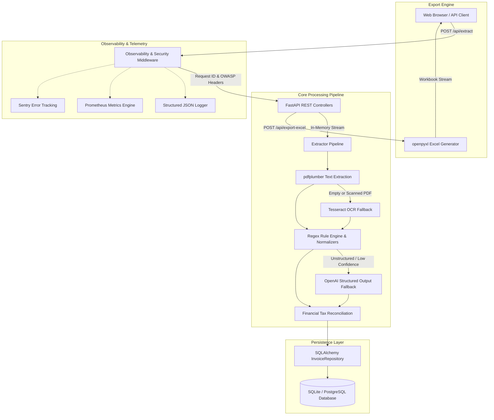
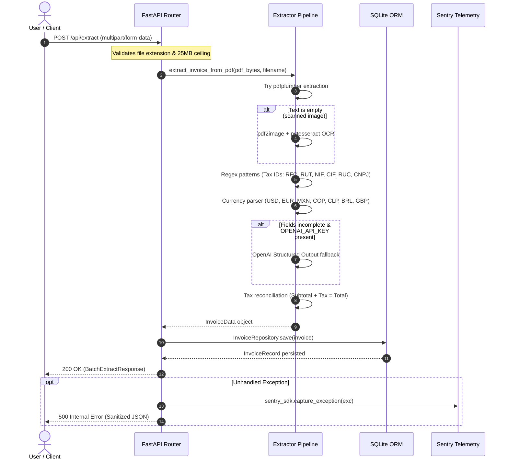

# InvoiceToSheet Architecture & System Design

This document details the software architecture, data flow, pipeline lifecycle, and telemetry infrastructure of the **InvoiceToSheet** microservice.

---

## 1. High-Level Architecture Overview

InvoiceToSheet is designed as a stateless, horizontally-scalable FastAPI microservice specialized in extracting structured financial data from non-standard PDF invoices and consolidating them into enterprise Excel workbooks.



---

## 2. Core Modules & Component Responsibilities

| Module | Responsibility | Key Classes & Functions |
| :--- | :--- | :--- |
| [`main.py`](file:///c:/Users/hflor/Downloads/Pruebas/main.py) | API gateway, route orchestration, CORS, static UI delivery. | `app`, `health_check`, `extract_invoices`, `export_excel`, `get_prometheus_metrics`. |
| [`extractor/`](file:///c:/Users/hflor/Downloads/Pruebas/extractor) | Modular package (`normalizers`, `ocr`, `llm`, `engine`, `pipeline`). | `extract_invoice_from_pdf`, `normalize_amount`, `normalize_date`, `extract_with_llm`, `RegexExtractor`. |
| [`database.py`](file:///c:/Users/hflor/Downloads/Pruebas/database.py) | Persistence layer, ORM models, session management. | `InvoiceRecord`, `InvoiceRepository`, `get_db`, `init_db`. |
| [`excel_generator.py`](file:///c:/Users/hflor/Downloads/Pruebas/excel_generator.py) | Styled Excel spreadsheet generation with formulas. | `generate_invoice_excel`. |
| [`observability.py`](file:///c:/Users/hflor/Downloads/Pruebas/observability.py) | Correlation ID tracing, Prometheus exposition, JSON logging. | `ObservabilityAndSecurityMiddleware`, `SystemMetrics`, `StructuredJsonFormatter`. |
| [`schemas.py`](file:///c:/Users/hflor/Downloads/Pruebas/schemas.py) | Pydantic v2 data contracts, boundary validation schemas. | `InvoiceData`, `BatchExtractResponse`, `ExportExcelRequest`. |

---

## 3. Extraction Pipeline Lifecycle



---

## 4. Multi-Currency Normalization

The normalization engine handles complex regional formatting conventions:

1. **Anglo-Saxon Notation:** `1,234.50` -> comma as thousand separator, period as decimal separator.
2. **European / South American Notation:** `1.234,50 €` / `R$ 4.500,75` -> period as thousand separator, comma as decimal separator.
3. **Chilean Peso (CLP):** Non-decimal whole units `CLP $ 850.000` -> normalized to `850000.0`.
4. **Auto-Reconciliation:** If subtotal and total are detected but tax amount is missing, tax is mathematically reconciled as `round(total - subtotal, 2)` with standard tax rate verification.

---

## 5. Telemetry & Metrics Design

### 5.1 Sentry Event Flow & Integration Protocol

Error tracking via Sentry SDK (`sentry-sdk[fastapi]>=2.0.0`) is designed to guarantee zero unhandled failure modes while avoiding hard runtime dependencies in disconnected environments:

1. **Conditional Boot Initialization (`main.init_sentry`):**
   - At startup, the server inspects the `SENTRY_DSN` environment variable.
   - If `SENTRY_DSN` is empty, unset, or whitespace, initialization is cleanly bypassed (`init_sentry() -> False`), ensuring local tests, sandbox runs, and development containers operate 100% offline without crashing or emitting warning telemetry.
   - When a valid DSN is provided, Sentry is initialized with non-intrusive trace sampling (`traces_sample_rate=0.1`) and PII protection (`send_default_pii=False`).

2. **Middleware Exception Capture Lifecycle:**
   - Any unhandled exception escaping controller logic is intercepted by `ObservabilityAndSecurityMiddleware.dispatch`.
   - The middleware checks if Sentry is active, formats the event context with correlation metadata (`request_id`, HTTP method, path, and sanitized client IP), and invokes `sentry_sdk.capture_exception(exc)`.
   - Sensitive values such as `OPENAI_API_KEY` are scrubbed before event serialization.
   - A sanitized HTTP 500 JSON response matching `ErrorDetail` is returned to the client, preventing internal stack trace leaks.

### 5.2 Metric Distinction: `/api/metrics` (JSON) vs `/metrics` (Prometheus)

The service provides dual observability endpoints catering to distinct monitoring consumers:

| Feature / Dimension | `GET /api/metrics` | `GET /metrics` |
| :--- | :--- | :--- |
| **Payload Format** | Structured JSON (`application/json`) | OpenMetrics text format (`text/plain; version=0.0.4`) |
| **Intended Consumer** | Frontend web UI, custom admin dashboards, quick curl health checks | Prometheus server, VictoriaMetrics, Grafana Agent scraper |
| **Key Metrics Exposed** | Aggregated object with `invoices`, `uptime_seconds`, `requests` | Counters (`_total`) with label dimensions: `{status="success\|warning\|error"}` |
| **Scraping Overhead** | Minimal JSON serialization via Pydantic model | Zero-allocation string concatenation adhering to Prometheus exposition standard |
| **Gauge Metrics** | `uptime_seconds` (float timestamp delta) | `invoicetosheet_uptime_seconds` (gauge) |

---

## 6. Database Migrations with Alembic

The persistence layer uses Alembic to guarantee schema reproducibility and prevent schema drift:

- **Migration Repository:** Located at `alembic/versions/` with autogenerated, version-controlled revision scripts.
- **Environment Integration (`alembic/env.py`):** Directly inspects `database.Base.metadata` and overrides the database URL dynamically from `config.settings.database_url`.
- **Automated Validation:** The CI pipeline validates schema forward-compatibility on every commit:
  ```bash
  DATABASE_URL="sqlite:///./test_migration.db" alembic upgrade head
  ```
- **Execution in Production:** Container entrypoints run `alembic upgrade head` before launching `uvicorn`.

---

## 7. Production Secret Management Pattern

InvoiceToSheet enforces zero plaintext credential persistence in repositories:

| Secret Identifier | Development Default | Production Secret Manager Injection Pattern |
| :--- | :--- | :--- |
| `DATABASE_URL` | `sqlite:///./invoices.db` | AWS Secrets Manager / Vault / Kubernetes Secret mounted as environment variable. |
| `OPENAI_API_KEY` | `""` (no-op regex fallback) | Injected via Docker secret file (`/run/secrets/openai_key`) or sealed secret. |
| `SENTRY_DSN` | `""` (no-op telemetry) | Injected dynamically per cloud environment (Staging vs Production). |

All environment parameters are parsed and strictly validated at service boot by [config.Settings](file:///c:/Users/hflor/Downloads/Pruebas/config.py), raising `ConfigurationError` on truncated or malformed keys.

